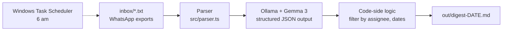

# sloth-digest 🦥

**A local AI that reads your exported group chats while you sleep and leaves a short morning digest. No cloud, no API key, no cost per message.**


-blue)


Built for the [Hacktoberfest Open-Source AI Challenge, Week 3: Slow and Steady](https://dev.to/challenges/hacktoberfest-week3-2026-10-19).

- 📝 Read the post on DEV: [POST](https://dev.to/noraprogramadora/sloth-digest-a-local-ai-that-reads-my-group-chats-while-i-sleep-26o4-temp-slug-5874492?preview=67f67fc080ec1f72e7710bdadeaac8b98d31c5b4af07057cf388976028c3d7ebc1eeafdf37e871e7919a5eec9e3e84192c124cb8145c9ab07a1d585f)
- 🎥 Demo video: [VIDEO DEMO](https://youtu.be/4BhDWZK64_M)

---

## The problem

Group chats pile up overnight. Reading 200 messages to find the two that matter ("can you send me the pricing doc by Wednesday?") is work nobody wants to do.

## What it does

1. You drop exported WhatsApp chats (`.txt`) into `inbox/`.
2. At a scheduled time (for example 6 am), a local model reads them.
3. You wake up to one Markdown file with:
   - **Needs you:** only the tasks assigned to you, with deadlines.
   - **Per chat:** a two-sentence summary and the key dates.

Small talk (pizza, coffee, football) is ignored.

Example output (from the synthetic chat in `samples/`):

```markdown
# Morning digest, 2026-10-23

## Needs you
- Send the updated pricing doc, due: Wednesday at noon. Asked by Maya in chat-team
- Review slides, due: Tomorrow afternoon. Asked by Priya in chat-team

## chat-team
The team needs to finalize the client demo, with Sam responsible for sending the updated
pricing document by Wednesday at noon... The demo time has been moved to Thursday at 4:30 PM.

- Client Demo: Thursday at 4:30 PM
```

## How it works



- **Parser:** turns the export into clean messages. It skips system lines, keeps multi-line messages together and drops `<Media omitted>`.
- **Structured output:** the model is called through Ollama's `/api/chat` with a JSON Schema in the `format` field, `temperature: 0` and an explicit `num_ctx`.
- **The model extracts, the code decides.** The model lists every task in the chat with an `assignee`. Plain code then keeps only the ones for you. A 4B model was unreliable at deciding "is this for me?" and at date arithmetic, so those parts live in code, where they are easy to verify.
- **Scheduled run:** a small shell script is called by Windows Task Scheduler through WSL.

## Why open-source AI

- **Your chats stay on your machine.** Nothing is uploaded to a server you don't control.
- **It runs offline** once the model is downloaded.
- **It costs nothing per run.** You can process every chat every day.
- **You can swap the model with one variable.** `OLLAMA_MODEL=gemma3:12b npm run digest -- inbox` changes the model without touching the code.

I did not benchmark this against a closed API, so I make no claim about accuracy compared to one.

## Getting started

### Prerequisites

- [Ollama](https://ollama.com) running locally
- Node.js 20+

### Install

```bash
ollama pull gemma3:4b
git clone https://github.com/nora-programadora/sloth-digest.git
cd sloth-digest
npm install
```

### Try it with the sample chat

```bash
npm run digest -- samples
```

The digest is written to `out/digest-YYYY-MM-DD.md`.

### Use your own chats

1. In WhatsApp, open a chat → **Export chat** → **Without media**.
2. Put the `.txt` file in `inbox/` (this folder is git-ignored).
3. Run:

```bash
DIGEST_USER="YourNameInTheChat" npm run digest -- inbox
```

`DIGEST_USER` must match your display name in the chat, because it decides which tasks are "yours".

> The parser expects the English (US) Android export format, for example `10/20/26, 9:06 PM - Maya: message`. Other locales and iOS exports are not supported yet.

### Scripts

| Script | What it does |
| --- | --- |
| `npm run parse` | Parses `samples/chat-team.txt` and prints the first messages |
| `npm run summarize` | Summarizes the sample chat and prints the raw JSON and the time taken |
| `npm run digest -- <folder>` | Summarizes every `.txt` in the folder and writes the Markdown digest |

### Environment variables

| Variable | Default | Purpose |
| --- | --- | --- |
| `OLLAMA_URL` | `http://localhost:11434` | Where Ollama is listening |
| `OLLAMA_MODEL` | `gemma3:4b` | Model used for the summaries |
| `DIGEST_USER` | `Sam` | Your name as it appears in the chat |

## Run it every morning (Windows + WSL)

This is the "set it up once" part. The project lives in WSL and Ollama runs on Windows.

**1. Make `localhost` work from WSL.** In `C:\Users\<you>\.wslconfig`:

```ini
[wsl2]
networkingMode=mirrored
```

Then run `wsl --shutdown` in PowerShell and reopen Ubuntu. Check with `curl http://localhost:11434/api/tags`. If you can't use mirrored mode, set `OLLAMA_URL` to your Windows host IP and make Ollama listen on it with `OLLAMA_HOST` (only on a network you trust).

**2. Test the script by hand:**

```bash
chmod +x scripts/run-digest.sh
./scripts/run-digest.sh
cat logs/digest.log
```

**3. Create the scheduled task** in PowerShell (replace `Ubuntu` with the name shown by `wsl -l -v`):

```powershell
schtasks /Create /SC DAILY /ST 06:00 /TN "SlothDigest" /TR "wsl.exe -d Ubuntu -e bash /home/<your-user>/sloth-digest/scripts/run-digest.sh"
```

**4. Run it once to test:** `schtasks /Run /TN "SlothDigest"`.

In Task Scheduler, enable "Run task as soon as possible after a scheduled start is missed", so a laptop that was off at 6 am still produces the digest when you turn it on. The laptop must be on (or awake) and Ollama running.

## Results

Test setup: AMD Ryzen AI 9 HX 370, 63 GB RAM, integrated GPU only, `gemma3:4b` through Ollama.

**Speed:** about 20 seconds for the 32-message sample chat (20.3 s and 19.8 s in two runs).

**Accuracy:** I iterated on a synthetic chat with known answers (two tasks for the user, one changed meeting time, a lot of small talk). Saved runs are in [`results/`](results/).

| Run | Change | What went wrong |
| --- | --- | --- |
| 1 | Baseline prompt | A task Maya promised to do was listed as the user's; relative dates ("tomorrow") left unresolved; "include monthly and annual plans" detail lost |
| 2 | Prompt asks to resolve dates | Dates became absolute, but the model **invented times** (4:00 PM, 9:00 AM) and picked the wrong day for "tomorrow" |
| 3 | Model extracts all tasks with an `assignee`, code filters | Assignment fixed. Dates still inconsistent (a Thursday labelled Oct 21) |
| 4 | Model copies deadlines verbatim, no date arithmetic | All 5 tasks correct, no invented times. Still missing "monthly and annual"; one typo in the summary |
| 5 | Source message and "tomorrow" resolved in code | [[TODO: fill in after running]] |

The lesson: for a 4B model, **don't ask for judgment or arithmetic you can do in code**. Extraction stays with the model, and filtering and dates move to code.

[[TODO: if you test gemma3:12b, add a row with time per chat and what improved or did not]]

## Limitations

- **Small model, real mistakes.** Details spread across messages can be lost (the "monthly and annual" requirement), the summary can retell a plan change instead of giving the final version, and the same event can appear twice in key dates. [[TODO: update after the latest fixes]]
- **Long chats are not chunked yet.** The model gets the whole chat in one call with `num_ctx: 8192`, so very long chats may be cut off.
- **Only WhatsApp `.txt` exports** in one locale format. No email yet.
- **Tested on one synthetic chat**, not on a large or varied set.
- **Relative deadlines** like "tomorrow afternoon" are resolved only when the exact phrase can be matched to a message.
- The laptop has to be on at the scheduled time.

## Ideas for next steps

- Chunk long chats and summarize in two passes.
- Support more export formats and email (IMAP).
- Try other open models and compare time and accuracy.

## Privacy note

`inbox/`, `out/` and `logs/` are git-ignored. The chats in `samples/` are invented; no real conversations are in this repo.

## License

MIT. See [LICENSE](LICENSE).

Built by Nora ([@nora-programadora](https://github.com/nora-programadora)).